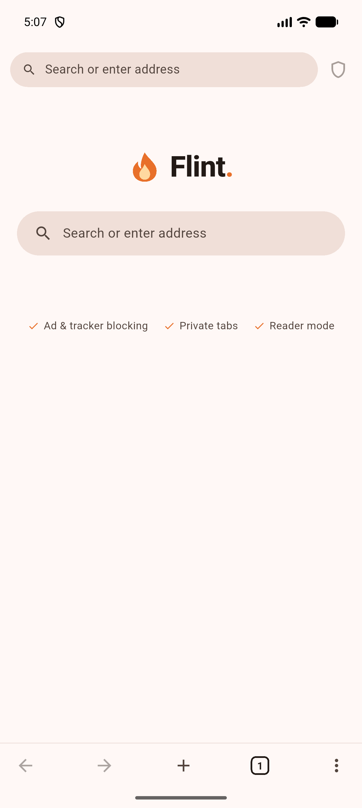
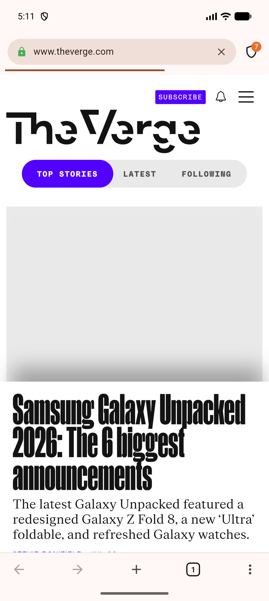

<h1 align="center">Flint for Android</h1>

<p align="center">
  <b>Fast, private mobile browser by <a href="https://github.com/Dhiva-Labs">Dhiva Labs</a>.</b><br>
  Built-in ad &amp; tracker blocking, private tabs, reader mode — zero telemetry.
</p>

<p align="center">
  
  &nbsp;&nbsp;
  
</p>

Flint for Android is the mobile companion to the [Flint desktop browser](https://github.com/Dhiva-Labs/FlintBrowser).
It's a Flutter app built on the system WebView (Chromium), so pages render exactly
as they do in Chrome, with Flint's privacy layer on top.

## Features

- **Network-level ad & tracker blocking** — a bundled 89k-domain blocklist blocks
  ad and tracker requests before they load, with a live per-page counter, a
  per-site on/off toggle, and an all-time total.
- **Tabs** — a visual tab switcher, plus **private tabs** that keep no history.
- **Reader mode** — distraction-free article view (Mozilla Readability) with
  font size and sepia/dark controls.
- **Omnibox** — one box for search or address, with history & bookmark suggestions.
- **Bookmarks, history & downloads** — all stored locally on the device.
- **Secure proxy ("VPN")** — an Opera-style browser VPN: route Flint's traffic
  through a secure proxy you choose (your own server or a provider's), with a
  one-tap connect toggle and a server list. Flint runs no servers and logs
  nothing, so no Dhiva Labs server ever sees your traffic. Browser-scoped, via
  Android's WebView `ProxyController`.
- **Find in page, desktop-site toggle, share, dark mode**, and a Flint home speed-dial.
- **Zero telemetry** — Flint sends nothing about you anywhere.

## Privacy

Everything stays on your device. There is no account, no sync server, and no
analytics. The only network requests Flint makes are the pages and downloads you
ask for.

> Note: on Android, a WebView browser cannot override system DNS, so secure DNS
> (DoH) is configured through Android's **Private DNS** system setting rather than
> in-app.

## Install

Download `flint-1.0.0.apk` from the [releases](https://github.com/Dhiva-Labs/FlintMobile/releases)
and open it on your device (you may need to allow installing from unknown sources).
The APK is signed with a development key, so Play Protect will show the usual
sideload prompt.

## Build from source

```bash
git clone https://github.com/Dhiva-Labs/FlintMobile.git
cd FlintMobile
flutter pub get
flutter run           # on a connected device or emulator
flutter build apk --release
```

Requires Flutter 3.44+. The project pins Android Gradle Plugin 8.9.1 / Gradle
8.11.1 for compatibility with `flutter_inappwebview`.

## Tech

Flutter · `flutter_inappwebview` (system WebView) · a hostname blocklist applied
via `shouldInterceptRequest` · `shared_preferences` for local storage ·
`@mozilla/readability` for reader mode.

## License

MIT © Dhiva Labs. Ad/tracker blocklist derived from
[Hagezi DNS blocklists](https://github.com/hagezi/dns-blocklists) (CC BY-SA).
